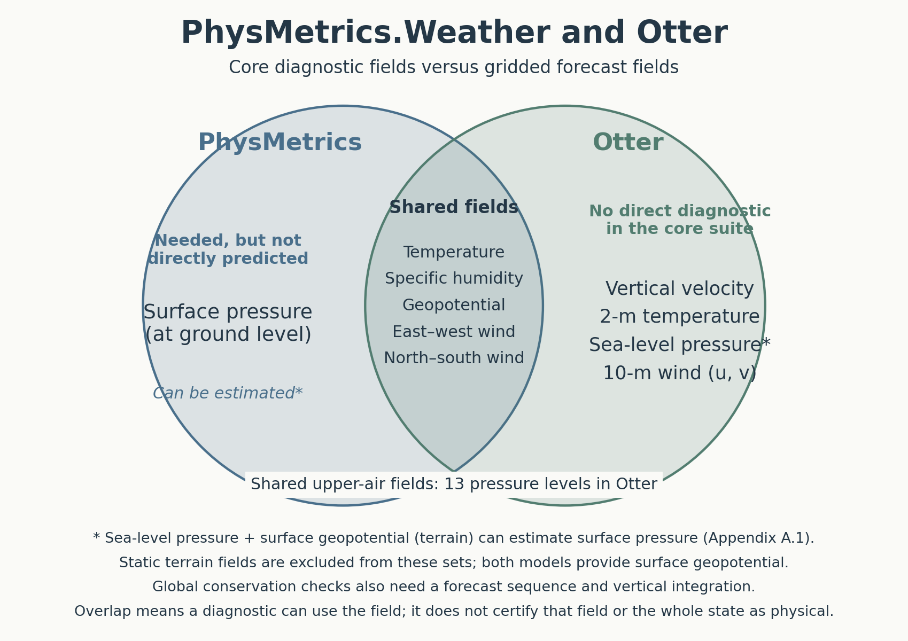
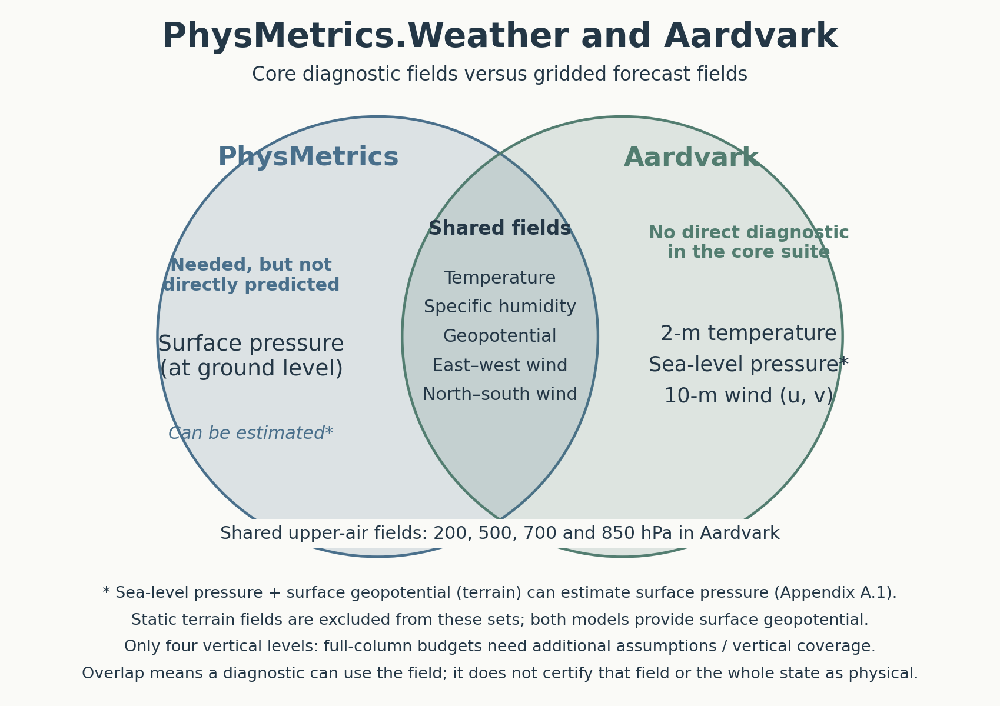

# PhysMetrics.Weather: An Evaluation Framework for Physical Consistency in ML Weather Models

Reading and notes started: 22 October 2026.

- **Evaluation framework**, not a weather forecasting model or attack method. It diagnoses physical consistency in forecasts produced by existing models.
- Three groups: mass/energy conservation; spectral energy across spatial scales; dynamical balances between atmospheric variables.
- Project relevance: compare clean and attacked forecasts using physical diagnostics alongside RMSE. These checks do not by themselves establish attack plausibility.
- Our regional five-variable CNN cannot support every diagnostic: global budgets and several vertical-balance checks need additional coverage/variables.

## Input screening and attack validity

- Norm bounds control disturbance size/support; physical consistency and detector evasion are separate checks. Our current experiments have not demonstrated evasion of a detector.
- Outputs are diagnostic scores, not a calibrated probability of a physically valid state. Thresholded screening would be an additional method requiring clean-data calibration and held-out evaluation.
- Some balance/spectral diagnostics can examine individual states with suitable fields; conservation drift needs temporal data. Regional budgets require boundary fluxes.
- Compare residuals with real-weather variability, not zero: genuine storms can depart from approximate balances. Passing these diagnostics does not establish complete physical plausibility or undetectability.

## Variable coverage

- Core fields: upper-air temperature, specific humidity, geopotential, east–west/north–south wind, and surface pressure. Static surface geopotential supplies terrain information.
- [Otter comparison](../figures/physmetrics_otter_venn.png): the five upper-air types are present at 13 levels. Vertical velocity, T2m and 10-m winds have no direct diagnostic in the core suite.
- [Aardvark comparison](../figures/physmetrics_aardvark_venn.png): the same five types at 200/500/700/850 hPa; compare its gridded states, not raw satellite observations. Full-column budgets need additional vertical assumptions/coverage.
- Neither directly predicts surface pressure. Both supply sea-level pressure and static surface geopotential; Appendix A.1 describes deriving an approximate surface pressure from these.
- Both include 500/850 hPa, enabling the published balance checks in principle. Having the variables does not guarantee every metric is applicable or establish physical validity.

Sources: [PhysMetrics, methods and Appendix A.1](https://arxiv.org/html/2606.10642v2), [Otter, Section 3.1](https://arxiv.org/html/2606.26421v1), [Aardvark, model description and Methods](https://www.nature.com/articles/s41586-025-08897-0).
